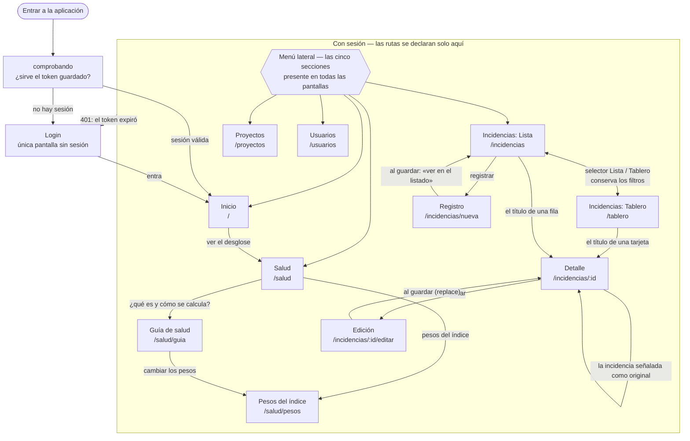
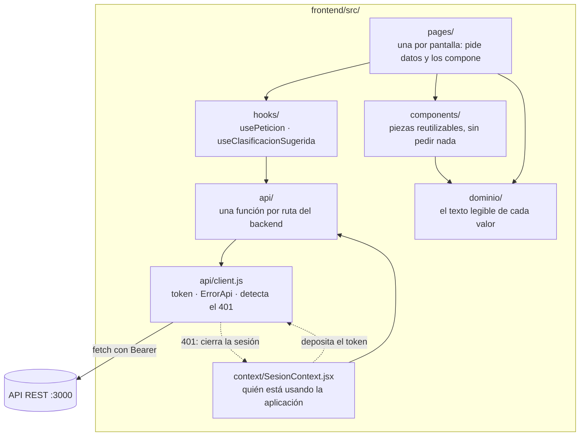

# Interfaz de usuario: pantallas y capas

Figura del frontend. Dos cosas que conviene mirar por separado: **qué pantallas
hay y cómo se llega a ellas**, y **por dónde pasa un dato desde el backend hasta
la pantalla**.

Sale de `frontend/src/App.jsx` (las rutas) y de la estructura de
`frontend/src/` (las capas).

## El mapa de pantallas

Tres detalles de la figura que son decisiones y no casualidades:

**El menú lateral es el eje de la navegación**, no las pantallas entre sí. Sus seis
secciones se declaran como datos en `components/MenuLateral.jsx`, así que agregar una
pantalla al menú es agregar una línea. Reemplazó a una cabecera horizontal en la
modernización: con siete secciones la barra de arriba se quedaba corta, y la columna
fija deja todo el ancho al tablero y al listado. Entre pantallas solo hay flechas donde una
tarea continúa en otra: del listado al detalle, del detalle a la edición.

**El registro vuelve al listado y no al detalle.** Al guardar muestra una
confirmación en su propio sitio —con la clasificación que se aplicó y el aviso de
duplicado si lo hubo— y ofrece «ver en el listado» o «registrar otra». Saltar al
detalle escondería justamente lo que hay que revisar: lo que el motor dedujo.

**La edición vuelve al detalle reemplazando la entrada del historial.** Con
`replace`, el botón atrás desde el detalle no vuelve al formulario ya enviado,
que es la trampa clásica de un formulario que navega al terminar.

La flecha punteada del 401 no la dibuja ninguna pantalla: la detecta
`api/client.js` en cualquier respuesta y cierra la sesión sola. Por eso sale del
recuadro completo y no de una pantalla concreta.

`comprobando` es un estado y no una pantalla, pero está en la figura porque
omitirlo produce un defecto visible: quien tiene sesión válida ve parpadear el
login mientras el backend confirma su token. Son **tres** situaciones, no dos.

Cualquier dirección que no exista redirige a `/` reemplazando la entrada del
historial, para que el botón atrás no traiga de vuelta la dirección equivocada.

## Las nueve pantallas

| Pantalla | Ruta | Qué resuelve |
|---|---|---|
| Login | — (fuera de sesión) | La única sin sesión; `App.jsx` decide cuál mostrar |
| Inicio | `/` | El índice global como número y la lista por proyecto, de peor a mejor |
| Listado | `/incidencias` | Filtros, búsqueda, orden y paginación, todo en la dirección |
| Registro | `/incidencias/nueva` | Clasificación sugerida en vivo y aviso de duplicados |
| Detalle | `/incidencias/:id` | Transiciones de estado, bitácora y descarte del duplicado |
| Edición | `/incidencias/:id/editar` | Corrige los campos que el sistema no controla |
| Salud | `/salud?proyecto=N` | Desglose del índice: los tres componentes con su peso y su evidencia |
| Proyectos | `/proyectos` | El listado para todos; crear, editar y eliminar para el administrador |
| Usuarios | `/usuarios` | El equipo, con las cinco reglas de acceso reflejadas en la tabla |

## Por dónde pasa un dato

| Carpeta | Su trabajo | Lo que no hace |
|---|---|---|
| `pages/` | Pedir los datos de una pantalla y componerla | Hablar con `fetch` directamente |
| `components/` | Dibujar una pieza con lo que recibe por props | Pedir datos: no conoce el backend |
| `hooks/` | Resolver "cargando / llegó / falló" en un solo lugar | Saber qué ruta se está pidiendo |
| `dominio/` | Traducir `EN_PROGRESO` a «En progreso» | Validar: aquí se dibuja, no se decide |
| `api/` | Traducir una función a una ruta | Adjuntar el token ni interpretar errores |
| `api/client.js` | Token, `ErrorApi` con `status` y `detalles`, el 401 | Conocer entidades |

Las dos flechas punteadas son el circuito de la sesión, y van en los dos
sentidos a propósito: el contexto **deposita** el token en el cliente al iniciar
sesión, y el cliente **avisa** al contexto cuando el backend responde 401. Si el
token se pasara pantalla por pantalla, bastaría olvidarlo una vez para tener una
pantalla que falla con 401 sin motivo aparente.

## Las cuatro decisiones que encierra la figura

**El estado de una pantalla vive en la dirección, no en `useState`.** El listado
guarda filtros, orden y página en la cadena de consulta
(`?estado=ABIERTA&pagina=2`), y el desglose del índice guarda el proyecto
(`/salud?proyecto=2`). Cuesta lo mismo y da tres cosas: enlaces que se pueden
compartir, el botón atrás deshaciendo el último filtro, y recargar sin perder el
trabajo.

**La máquina de estados no se duplica aquí.** Qué transiciones existen lo dice el
backend en `transiciones_posibles`, que viene en el detalle y en la respuesta de
la transición. El frontend solo aporta el texto de los botones y si el motivo es
obligatorio (`ACCIONES_TRANSICION` en `dominio/incidencias.js`). La regla la hace
cumplir el servidor: si las dos discreparan, se pide un motivo de más o llega un
400 que la pantalla ya muestra junto al campo.

**La interfaz refleja los permisos; no los hace cumplir.** Esconder un botón no
es seguridad: el rol se comprueba en el servidor y ahí es donde importa. Lo que
la pantalla aporta es no ofrecer algo que iba a responder 403. Por eso
`/proyectos` y `/usuarios` son **una sola pantalla por entidad** con las acciones
condicionadas al rol, y no una sección de administración aparte que repita la
misma tabla.

**Sin dependencias más allá de React y el enrutador.** No hay librería de estado,
ni cliente HTTP, ni librería de estilos, ni librería de gráficos: las figuras de
datos son barras hechas con dos `div` y un `width` en porcentaje. El enrutador
entró al aparecer la segunda pantalla dentro de la sesión, que es cuando empezó a
resolver algo que no conviene escribir a mano.

## Mantenimiento

Esta figura repite lo que declaran `App.jsx` y la estructura de carpetas. Si se
agrega una pantalla, se editan los dos: el código es la verdad y la figura es la
explicación.

El reparto en capas del backend está en
[`arquitectura.md`](arquitectura.md); las reglas que ambas figuras resumen están
escritas con más detalle en [`../../CLAUDE.md`](../../CLAUDE.md).
