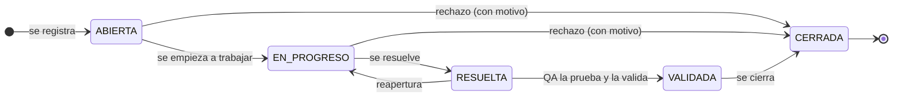

# Máquina de estados de una incidencia

Figura del flujo de trabajo. Es la traducción del dato `TRANSICIONES` de
`backend/src/services/incidencia.service.js`, que es donde la máquina vive de
verdad.

El flujo sigue el **ciclo de vida del defecto** que se usa en aseguramiento de
calidad, simplificado a cinco estados. En pantalla, `ABIERTA` se muestra como
**Pendiente** y `EN_PROGRESO` como **En desarrollo**; los valores internos se
conservaron para no rehacer los datos, el índice de salud ni las pruebas por un
cambio de nombre.

## Correspondencia con el ciclo de vida del defecto

| Etapa del ciclo | En el sistema | Cómo se representa |
|---|---|---|
| Nuevo | `ABIERTA` (Pendiente) | Estado |
| Asignado | Campo `asignado_a` | La incidencia sigue pendiente, pero con responsable |
| Activo | `EN_PROGRESO` (En desarrollo) | Estado |
| Para probar | `RESUELTA` | Estado |
| Verificado | `VALIDADA` | Estado |
| Cerrado | `CERRADA` | Estado final |
| Reabierto | `RESUELTA → EN_PROGRESO` | Transición, registrada en la bitácora |
| Rechazado | `ABIERTA → CERRADA` y `EN_PROGRESO → CERRADA` | Transición con motivo obligatorio |
| Aplazado | — | No se implementa: el sistema no gestiona sprints ni versiones |

## Las siete transiciones, en detalle

| Desde | Hacia | Significado | Motivo | `fecha_resolucion` |
|---|---|---|---|---|
| — | `ABIERTA` | Se registra la incidencia | — | nula |
| `ABIERTA` | `EN_PROGRESO` | Alguien la toma y empieza a trabajar | opcional | sin cambio |
| `ABIERTA` | `CERRADA` | Rechazo sin trabajo: duplicada, no es un defecto, no se reproduce | **obligatorio** | queda nula |
| `EN_PROGRESO` | `RESUELTA` | Hay una solución lista para probar | opcional | **se asigna** |
| `EN_PROGRESO` | `CERRADA` | Rechazo descubierto al investigar | **obligatorio** | queda nula |
| `RESUELTA` | `EN_PROGRESO` | Reapertura: QA la probó y no está resuelta | opcional | **se borra** |
| `RESUELTA` | `VALIDADA` | QA la probó y funciona | opcional | se conserva |
| `VALIDADA` | `CERRADA` | Se cierra después de validada | opcional | se conserva |

## Las decisiones que encierra la figura

**Lo resuelto pasa por QA antes de cerrarse.** `RESUELTA` ya no va directo a
`CERRADA`: tiene que pasar por `VALIDADA`. Es lo que pide el ciclo de vida del
defecto (el cierre ocurre después de las pruebas de calidad), y lo echó en falta
una participante de la prueba de usuarios. `VALIDADA` no admite reapertura: si QA
la validó, la solución funciona; un problema que aparezca después es una
incidencia nueva.

**`CERRADA` es un estado final.** No tiene salidas. Si el proyecto necesitara
reabrir incidencias cerradas, basta agregar `'EN_PROGRESO'` a su lista en
`TRANSICIONES` y el resto del sistema se adapta solo: los botones de la interfaz
se dibujan desde `transiciones_posibles`, que el backend calcula.

**Hay dos caminos de rechazo, y los dos exigen motivo.** `ABIERTA → CERRADA` cubre
lo que se descarta sin trabajarlo (el caso típico lo genera el detector de
duplicados); `EN_PROGRESO → CERRADA`, lo que se descubre al investigar: no es un
defecto o no se puede reproducir. Sin esa segunda salida, habría que marcarla
`RESUELTA` y la bitácora diría que se arregló algo que nunca estuvo roto. En los
dos casos el motivo es la única explicación que quedará, y por eso es
obligatorio (`TRANSICIONES_QUE_EXIGEN_MOTIVO`). Como no hubo resolución,
`fecha_resolucion` queda nula.

**La reapertura borra la fecha de resolución; validar y cerrar la conservan.** Al
reabrir, la fecha anterior dejó de ser cierta. Al validar y cerrar, la resolución
sigue siendo la que fue: el tiempo de resolución mide el trabajo de desarrollo,
no la espera de QA. Además, una reapertura es exactamente un registro del
historial con `estado_anterior = 'RESUELTA'` y `estado_nuevo = 'EN_PROGRESO'`, y
es así como el índice de salud mide la tasa de reapertura.

**`VALIDADA` cuenta como trabajo pendiente para el índice.** Mientras nadie la
cierre, sigue en la lista del equipo; sacarla haría que el índice mejorara por
dejar incidencias validadas sin cerrar.

## Cómo se hace cumplir

El orden de los estados es una regla de negocio, no una restricción de datos: SQL
puede limitar **qué** valores admite la columna (lo hace un `CHECK`), pero no en
**qué orden** pueden ocurrir, porque para eso hay que conocer el estado anterior.

Por eso la única vía para cambiar el estado es
`POST /api/incidencias/:id/transicion`, nunca un `PUT` del campo: la operación
valida la transición, ajusta la fecha de resolución y escribe la bitácora, las
tres cosas dentro de una transacción. Un `PUT` del campo se saltaría el historial
y la tasa de reapertura quedaría mintiendo.

Las transiciones ilegales responden **409 Conflict**, no 400: la petición está
bien formada y la misma operación podría ser válida más adelante; lo que falla es
que no corresponde en el estado actual.

Las once pruebas del grupo «Maquina de estados» en
`backend/tests/funcionales.test.js` recorren este diagrama completo: el flujo
legal con la validación, los saltos prohibidos (cerrar sin validar, reabrir lo
validado), el estado final, el motivo obligatorio de los dos rechazos y los
comportamientos de `fecha_resolucion`.
